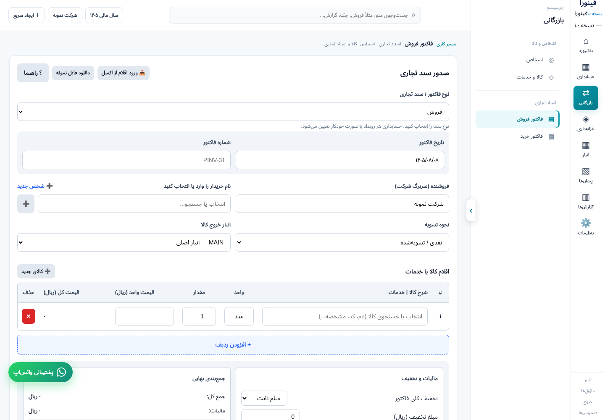
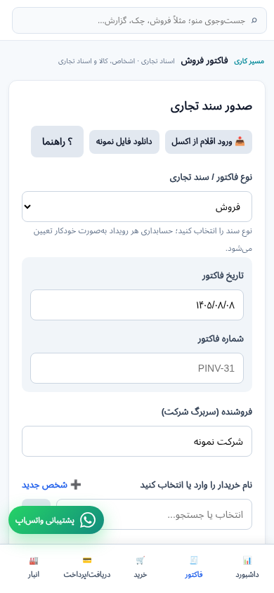
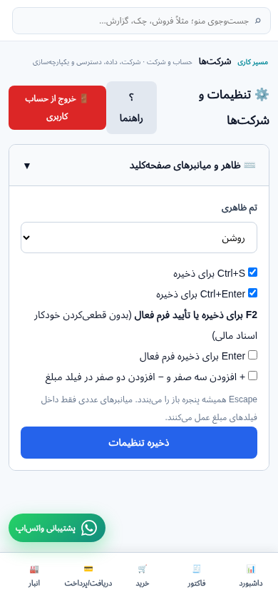
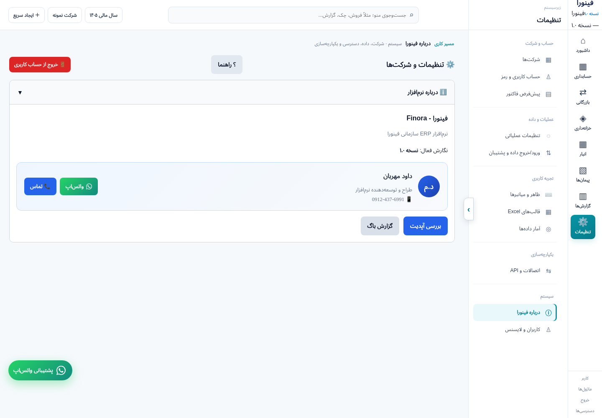

# ممیزی تعاملات و تجربهٔ کاربری فینورا

مبنای کد: `357cfb2edaa0caa4d59ba89406eeea3bafc80080`. این گزارش بین تحلیل کد، کلیک آزمایشی و پذیرش واقعی تفاوت می‌گذارد. تضمین «تمام دکمه‌ها در تمام نقش‌ها و حالت‌ها درست‌اند» هنوز قابل ارائه نیست.

## شواهد اجرا

- ۲۰۳/۲۰۳ آزمون مرورگر موجود در اجرای تازه موفق شد؛ ۴۹/۴۹ آزمون سرور و Golden accounting نیز موفق‌اند. این تعداد، درصد پوشش دکمه‌ها نیست.
- ۷۳۴ محل تعریف کنترل در ۵۷ فایل شناسایی شد؛ شامل۲۱۳ درHTML و۵۲۱ در قالب‌های JS. تکرارهای رکوردی یا حالت‌های نقش، مخرج ثابت این شمارش نیستند.
- در اجرای ایزوله۶۵۱ کنترل متفاوت مشاهده شد. همهٔ۷۶ فرمان منو به نمای مقصد رسیدند:۵۰ با ورود از دکمهٔ نوار،۲۶ با آماده‌سازی مستقیم ماژول و سپس کلیک زیرمنو. مسیر launcher برای۲۶ مورد از این نتیجه اثبات نمی‌شود.
- ۱۴۵ ریشهٔ فراخوانی handler بررسی شد؛ مورد `this.closest` روش عنصر DOM است و نباید تابع مفقود گزارش شود. نام تابع معتبر، نتیجهٔ صحیح عملیات را اثبات نمی‌کند.
- گزارش TinyFish اجرای `37baeb67-76d8-4706-b0a9-61c810e47ee3` فقط بازدید۷از۸ ماژول و تعداد محدودی زیرمنو را توصیف کرد. تنظیمات و خرید کامل بررسی نشد. لینک سایت به‌جای فایل تصویر ارائه شد؛ آن‌ها مدرک تصویری پذیرفته‌شده نیستند. هیچ نوشتن Production در این اجرا انجام نشد.
- تصاویر زیر از مرورگر واقعی روی نسخهٔ محلی با دادهٔ مصنوعی‌اند؛ هیچ دادهٔ مشتری داخل تصاویر نیست. تصویر پنل مدیر که در وضعیت بارگذاری بود از ممیزی بصری کنار گذاشته شد.

## گام‌های بصری پذیرفته‌شده

|گام|صفحه|وضعیت و مشاهده|
|---|---|---|
|۱|داشبورد دسکتاپ|ساختار روشن و شرکت/سال مالی قابل مشاهده؛ دادهٔ خالی نمودار باید با اقدام راهنما همراه باشد|
|۲|سند حسابداری|بدهکار/بستانکار و اختلاف دیده می‌شود؛ دسترسی صفحه‌کلید و نام دکمه‌های آیکونی باید جدا سنجیده شود|
|۳|فاکتور دسکتاپ|مسیر و ردیف اقلام روشن؛ فرم بلند و اقدام اصلی پایین‌تر از محدودهٔ اول صفحه است|
|۴|دریافت/پرداخت|فرم قابل فهم؛ چیدمان تک‌ستونی در دسکتاپ برای کار پرتکرار طولانی است|
|۵|شرکت‌ها|فیلدهای هویتی متعدد؛ دلیل غیرفعال‌بودن ذخیره باید نزدیک عمل مشخص باشد؛ رفتار واقعی Edit در اجرای قبلی جدا ثبت شده|
|۶|فاکتور موبایل|چیدمان عمودی برقرار؛ پشتیبانی شناور روی محدودهٔ طرف حساب قرار گرفته و نیازمند آزمون مزاحمت لمس است|
|۷|تنظیمات موبایل|کارت میان‌بر و ذخیره واضح؛ خروج از حساب برجسته‌تر از برخی کارهای اصلی و متن عنوان شکسته است|

از تصاویر به‌تنهایی ادعای انطباق WCAG، کیفیت مالی، درست‌بودن مجوز یا ذخیرهٔ سرور نمی‌کنیم. تضاد رنگ، نام دسترس‌پذیر، Tab/Escape، فوکوس مودال و zoom۲۰۰٪ باید اندازه‌گیری شوند.

## مقایسه و اولویت‌ها

[پژوهش منابع رسمی QuickBooks، Xero، Zoho Books، Sage Intacct و NetSuite](competitor-comparison.md) شامل پیوند منابع و تفاوت «وجود قابلیت» با «کیفیت تجربه» است؛ حساب رقبا عملاً آزموده نشده و رتبه‌بندی سهم بازار ارائه نشده است.

۱. P0: دفتر پوشش هر کنترل×نقش×حالت، خطاهای قابل‌بازتولید، ذخیره و پیام موفقیت واقعی، تست منفی مجوزها و چندشرکتی.
۲. P1: گرید مشترک فاکتور/خرید/اسناد با فیلتر، مرتب‌سازی و نمای ذخیره‌شده؛ وضعیت یکسان اسناد و تاریخچهٔ اصلاح؛ داشبورد کارهای نیازمند اقدام.
۳. P1: اقدام اصلی در دسترس در فرم‌های بلند، جای مناسب پشتیبانی موبایل، برچسب‌های دسترس‌پذیر و بازگشت فوکوس.
۴. P2: راه‌اندازی مالی مرحله‌ای شرکت، ورود Excel با پیش‌نمایش و خطای ردیف، مغایرت بانکی فایل‌محور با تکرار امن، سپس پورتال مشتری.

## مرزهای باز و نیاز ابزار

ابزار جدید برای پژوهش رقبا یا تست ایزوله لازم نیست. برای پذیرش کامل، دادهٔ آزمایشی کافی برای فرم‌ها/ردیف‌ها، نقش‌های واقعی مدیرکل/مدیرشرکت/کاربرمحدود، محیط مستقل برای نوشتن مالی و سناریوهای قطع شبکه/هم‌زمانی لازم‌اند. Supabase و GitHub در دسترس‌اند؛ TinyFish گاهی خطای داخلی دارد و اجرای اخیر محدود بود. حساب Production را برای پرکردن پوشش حذف/قطعی‌سازی/تغییر رمز به‌طور تصادفی تغییر نمی‌دهیم.

فهرست CSV وJSON ضمیمه، کنترل‌های مشاهده‌شده و نتیجهٔ هر مسیر را قابل بررسی می‌کند. وجود متن handler در فایل تست، پوشش اجرایی نیست؛۴۵۷ مورد بدون ارجاع لغوی تست نیز لزوماً۴۵۷ خرابی نیست.

## نتیجهٔ پیمایش مستقل دکمه‌ها

۲۲۱ handler متمایز دکمه در۲۲۱ نشست تازهٔ ایزوله بررسی شد؛۱۲۸ کلیک اجرا شد و خطای JavaScript ثبت نشد.۹۳ کنترل در حالت دادهٔ خالی/مسیر آماده‌شده پنهان یا غیرفعال ماندند و آزموده‌شده محسوب نمی‌شوند. دیالوگ‌های تأیید رد شدند؛ نتیجهٔ کلیک، اثبات انجام حذف/پرداخت/ثبت سرور نیست. تمام درخواست‌های بیرونی مسدود و datastore مصنوعی بود.

[جدول قابل جست‌وجو](index.html) · [نتیجهٔ هر دکمه](button-click-results.json) · [نتیجهٔ منوها](menu-click-results.json)

برای بستن۹۳ مورد باقی‌مانده باید fixture اختصاصی ساخته شود: حساب واردنشده برای ورود/OTP، فرم ایجاد/اصلاح با رکورد مصنوعی، اسناد پیش‌نویس/قطعی برای اقدامات مالی، مودال‌های تنظیمات/پروژه و انواع درخواست. افزودن صرفِ کلاس active به مودال یا دورزدن شرط مجوز، آزمون معتبر مسیر کاربر نیست. پوشش خواندنی/انقضای لایسنس/قطع شبکه/شرکت دوم نیز جدا ثبت شود.

## بازتولید ابزارها

از ریشهٔ پروژه و با وابستگی Playwright موجود: `python docs/audits/2026-10-31/tools/inventory.py`؛ سپس یک سرور محلی روی4173، `node docs/audits/2026-10-31/tools/runtime.cjs` و `node docs/audits/2026-10-31/tools/button-sweep.cjs`. خروجی پیش‌فرض در `/tmp/finora-controls-audit` است و با FINORA_AUDIT_OUT قابل تنظیم است. Chromium سیستم در `/usr/bin/chromium` لازم است. این‌ها ابزار ممیزی دستی‌اند، نه جایگزین تست‌های assertionدار.

## دو ایراد عملکردی تأییدشده، هنوز اصلاح نشده

- P1، تنظیمات ← درباره: «بررسی آپدیت» صرفاً `alert` ثابت اجرا می‌کند و بدون درخواست یا مقایسهٔ نسخه ادعای آخرین نگارش دارد. روی دکمهٔ واقعی پس از بازکردن آکاردئون بازتولید شد. معیار رفع: نسخهٔ نصب/منتشر مقایسه شود؛ خطای شبکه یا نبود متادیتا هرگز پیام به‌روز بودن نسازد.
- P1، همان صفحه: «گزارش باگ» صرفاً پیام «پشتیبانی فعال است» دارد؛ فرم، مسیر ارسال یا ثبت گزارش وجود ندارد. معیار رفع: بازکردن مسیر واقعی گزارش با توضیح، بدون ارسال خودکار اطلاعات کاربر.

این دو مورد به اجرای JS خطا نمی‌دهند؛ بنابراین128کلیک بدون خطای JS به معنی128عملکرد صحیح نیست. نمونهٔ روشن علت لزوم assertion نتیجه‌اند.

